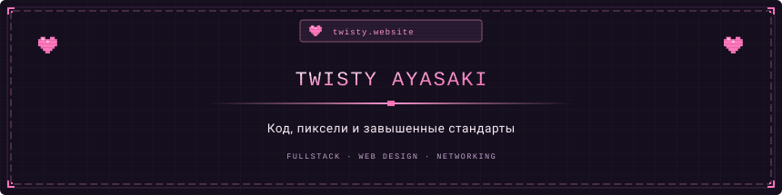

 

  
  

---

### Reality Check

Фуллстак-разработчик, веб-дизайнер и немного девопс. 
- **Подход:** если что-то можно вырезать - это будет вырезано.
- **Стек:** C++, TypeScript, Python, Node.js, Linux internals, Low-level networking, UI/UX
-  **Языки:** Свободно владею русским. Не менее свободно не владею остальные 7169 языков.
- **Сайт:** [twisty.website](https://twisty.website)

---

### Activity

  

 

  превзошёл сам себя· 2026

